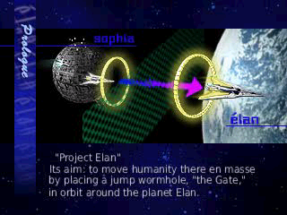
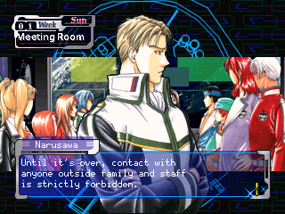
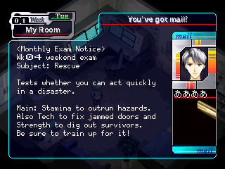
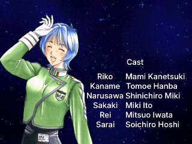

# Élan Plus — English Translation

An unofficial, complete English fan translation of **Élan Plus** (エランプラス), the training and
communication simulation by VISCO for the PlayStation (2000, SLPS-02759). You are one of nine
candidates on Station Alpha competing for the two places on the expedition to the planet Elan: over
24 weeks you train, sit monthly exams, send mail and get to know the other candidates, and at the
end you choose (and hope to be chosen by) a partner. This repository holds the translation, the
tools that build the patch from your own copy of the game, and the documentation. It contains no
game data.

<p align="center">
  
  
  <br>
  
  
</p>

More screenshots are in [docs/screenshots](docs/screenshots).

## Status

**v1.0.1 — complete.** Everything in the game is in English:

- All 230 story scenes and every choice, on both the male and the female player route.
- All free-roam conversations with the candidates (48 files) and their goodbye lines.
- Mail replies, the ALPHA DATABASE hint entries and the monthly exam notices.
- Name plates, location and weekday labels, training stats, results tables and rankings.
- Interface text stored in the game code: tutorial pop-ups, messages, exam screens, save/load slots.
- Redrawn graphics: facility list and menu buttons, result panels and banners, mail prompts, the
  gender, name-entry and confirmation screens, title menu, Partner Select and Quit prompts.
- The prologue movie (captions removed and redrawn in English) and the nine monthly-exam title cards.
- Extras: the voice-actor interview screens and the gallery.
- The ending staff roll.

The opening and ending movies have no Japanese text and are unchanged. Every ending has been played
through. See the [changelog](CHANGELOG.md) for the version history.

## Download & apply

1. Download **`ElanPlus_EN.xdelta`** (and `ElanPlus_EN.cue`) from the
   [Releases page](https://github.com/waifoof/Elan-Plus-English-Patch/releases).
2. You need your own dump of the original Japanese disc as a single `.bin` (MODE2/2352). Check it
   before patching:

   | `Elan Plus (Japan).bin` | |
   |---|---|
   | Size | 581,621,376 bytes |
   | CRC32 | `91D628D6` |
   | MD5 | `743a8dfa46d8d8f8b9aa49abbaf1b4ec` |
   | SHA-1 | `947de2fba102fa48c63e39ce880eaddcec91b9b4` |

   The checksums of the patched result are in [CHECKSUMS.md](CHECKSUMS.md).

   If your dump's checksums differ, the patch will refuse to apply or produce a broken image.
3. Apply the patch:
   - **Windows (GUI):** use [Delta Patcher](https://github.com/marco-calautti/DeltaPatcher). Original
     file: `Elan Plus (Japan).bin`, patch: `ElanPlus_EN.xdelta`. If it complains, untick
     "Checksum validation".
   - **Command line (xdelta3):**

     ```sh
     xdelta3 -d -B 1073741824 -s "Elan Plus (Japan).bin" ElanPlus_EN.xdelta ElanPlus_EN.bin
     ```

     The `-B 1073741824` option matters: it gives xdelta3 a source window big enough for the whole disc.
4. Put `ElanPlus_EN.bin` next to `ElanPlus_EN.cue` and open the `.cue` in your emulator.

The patched image is about 45 MB larger than the original and still fits on a CD-R.

### Playing

- Tested in **PCSX-ReARMed** from the first boot to the end credits on both routes, including every
  partner ending. **DuckStation** is recommended. Real PlayStation hardware has not been tested yet;
  reports are welcome.
- As in most Japanese PS1 games, **Circle confirms** and **Cross cancels**.
- The name-entry screen opens on the kana grid: switch to the **Alphabet** tab to type an English
  name (up to 4 letters).
- The final exam is in week 24. To be accepted as a partner, a candidate needs to like you: talk to
  them, train with them and pick kind replies.

## Known issues

All cosmetic. A few examples: typed names show a small gap between letters (the default name reads
"Na o"), the day-change card's "Wednes day" is the original game's own English artwork, some menu
slots use short forms, and most staff-roll names are a best-guess reading. Full list:
[KNOWN_ISSUES.md](KNOWN_ISSUES.md).

Found something else? [Open an issue](https://github.com/waifoof/Elan-Plus-English-Patch/issues/new/choose)
with a screenshot and roughly where in the game it happened.

## Building from source

The patch can be rebuilt from this repository and your own disc image with one command:

```sh
pip install -r requirements.txt
scripts/setup_deps.sh                       # builds mkpsxiso, xdelta3 and jPSXdec into tools/deps/
python3 build.py --disc "Elan Plus (Japan).bin"
```

The build is deterministic: the result in `out/` matches the checksums in [CHECKSUMS.md](CHECKSUMS.md). Linux or WSL; see
[docs/BUILDING.md](docs/BUILDING.md) for the requirements and what each step does.

The Japanese text is not stored here: the build reads it back from your disc. To edit the
translation, see [docs/TRANSLATING.md](docs/TRANSLATING.md), the [style guide](docs/STYLE_GUIDE.md),
and the [engine notes](docs/ENGINE_NOTES.md) for how the game works.

## Contributing

Bug reports and text fixes are very welcome. See [CONTRIBUTING.md](CONTRIBUTING.md).

## Credits

- **Translation:** waifoof
- **Original game:** VISCO Corporation (2000)
- **Tools used:** [jPSXdec](https://github.com/m35/jpsxdec) (movie re-encoding),
  [mkpsxiso / dumpsxiso](https://github.com/Lameguy64/mkpsxiso) (disc extraction and rebuilding),
  [xdelta3](https://github.com/jmacd/xdelta) (patch), [PCSX-ReARMed](https://github.com/libretro/pcsx_rearmed) (testing)
- **Fonts for the redrawn graphics:** [Inter](https://github.com/rsms/inter) and
  [Carlito](https://github.com/googlefonts/carlito) (SIL Open Font License),
  [DejaVu](https://dejavu-fonts.github.io/) (Bitstream Vera licence). Licence texts are in [fonts/](fonts).

## Licence and disclaimer

The tools, documentation and translation text in this repository are released under the
[MIT License](LICENSE), copyright 2026 waifoof. The bundled fonts keep their own licences.

This is an unofficial fan project, not affiliated with or endorsed by VISCO or any rights holder.
Élan Plus is © VISCO Corporation. This repository contains no game data: no disc image, no
extracted files and no Japanese script text. The patch only works on your own copy of the original
disc, which you need to have legally obtained. Please support the original.
